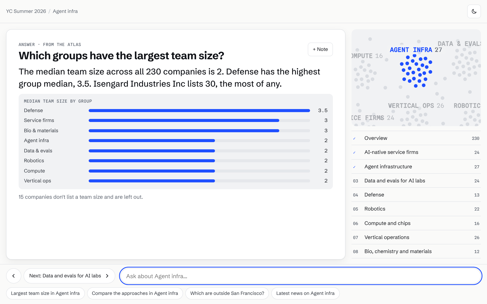
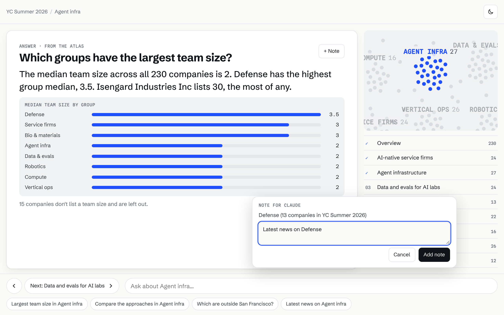

# Atlas Briefing

A Claude skill that turns a big collection into a one-screen briefing you can page through, question, and annotate, then researches your notes for you.

Point it at something with too many entries to read ("all 230 companies in YC Summer 2026", "every talk at this conference", "this year's grant awards"). Claude sharpens what you want from it, reads the official source, groups the items with quoted evidence, and publishes an interactive atlas as a Claude artifact. You get the lay of the land in a few minutes without scrolling a list or opening tabs.


## What the viewer gets

| | |
|---|---|
| **One screen, like slides.** ← → through an overview and one page per group. Nothing scrolls on a laptop; long groups page in sets. |  |
| **Evidence you can see.** Each item's own one-liner, with the phrase that put it in its group highlighted. Placements without such a phrase are labelled *judgment call*. |  |
| **Instant answers.** Counts, rankings, places and "how were these grouped?" answer at once from the data. Open questions go to the viewer's own Claude, which may only use the atlas, and cite it. |  |
| **Stack questions for later.** "+ Note", or any question about news or funding, becomes a note: a comment on the atlas. Add as many as you like, then send them to Claude in one go. Claude researches each on the web and replies in its thread. |  |

Light and dark themes; keyboard: ← → page, `/` ask, `N` note, `Esc` back.

## How it works

```
You: "make an atlas of …"
 │
 ├─ 1 Intent     up to 3 questions, each with a default: who it's for, the exact collection, the source of record
 ├─ 2 Collect    items from the official source; summaries copied verbatim, facts left null when not stated
 ├─ 3 Group      4–8 groups with rubrics; membership needs a phrase quoted from the item's own summary
 ├─ 4 Validate   scripts/build.mjs refuses unquoted evidence and counts the data doesn't support
 └─ 5 Publish    prebuilt player + inlined data → one HTML page → Claude artifact
                         │
          viewer pages, asks, leaves notes (artifact comments)
                         │
You: "research my atlas comments"  →  Claude answers each thread with sources, resolves it
```

Cost: building an atlas is one Claude conversation. Viewing it costs nothing; open questions run on the viewer's own Claude plan. No API keys, servers or third-party services.

## Install

Copy or symlink the skill folder into your Claude skills:

```bash
git clone https://github.com/mahtabsoin/atlas-briefing
ln -s "$PWD/atlas-briefing/skills/atlas-briefing" ~/.claude/skills/atlas-briefing
```

The skill needs Node 18+ and nothing else: the player ships prebuilt in `skills/atlas-briefing/assets/player.html`. In a Claude chat, upload the `skills/atlas-briefing` folder as a skill.

## Use

- **Build:** "Make an atlas of every company in YC Summer 2026 for a journalist who covers AI." Answer the intent questions or say "go".
- **Ask:** in the atlas, type in the box. Instant answers come from the data; open questions use your Claude.
- **Research:** leave notes, press "Send N notes to Claude", or say "research my atlas comments" in any Claude chat with the skill.

Sharing: a personal or team atlas declares full comments, which keeps it inside your organisation. For a public link, publish with composer-only comments; viewers then type notes in Claude's own comment box. See [SKILL.md](skills/atlas-briefing/SKILL.md#5-build-and-publish).

## Example: YC Summer 2026

[`atlases/yc-s26/collection.json`](atlases/yc-s26/collection.json): 230 companies from the YC directory (read 2026-10-21), 164 in eight groups, 9 of them judgment calls, 66 ungrouped. Rebuild it with:

```bash
node skills/atlas-briefing/scripts/build.mjs atlases/yc-s26/collection.json
```

## Limits

- Built for 50 to 600 items and 4 to 8 groups. Split bigger collections.
- An atlas is a snapshot of its source on the date shown. Rebuild to refresh.
- Instant and open answers only know the atlas; anything beyond it (news, money) goes through notes and web research.
- Notes need the atlas open in Claude. Opened as a plain file, the page pages and answers instantly, and "Send" copies the notes as text, the one place copying is unavoidable.
- No voice: artifacts can't use the microphone in Claude today.

## Repository

| Path | What |
|---|---|
| [`skills/atlas-briefing/`](skills/atlas-briefing/) | The skill: instructions, data format, builder, prebuilt player |
| [`atlases/yc-s26/`](atlases/yc-s26/) | The worked example |
| [`player/`](player/) | Player source (React + Vite) for changing the page itself |
| `docs/screenshots/` | The images above |
