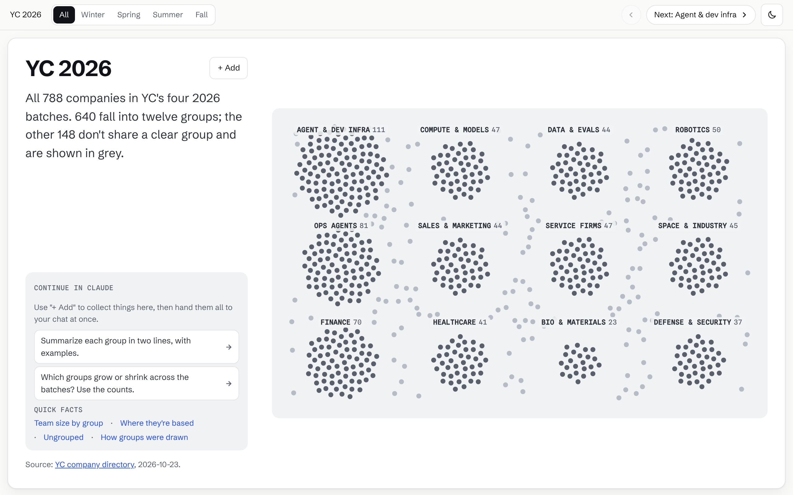
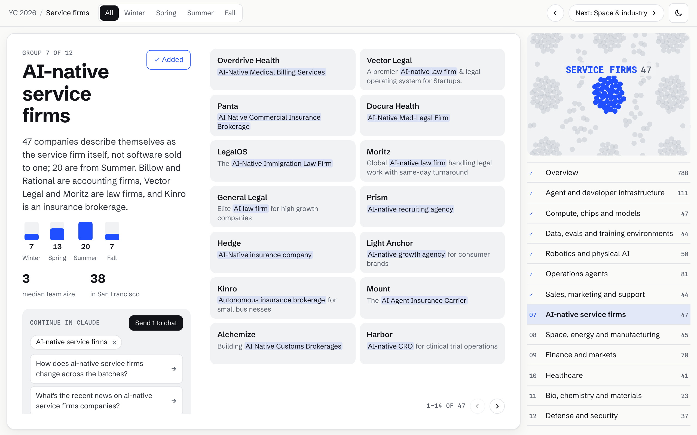
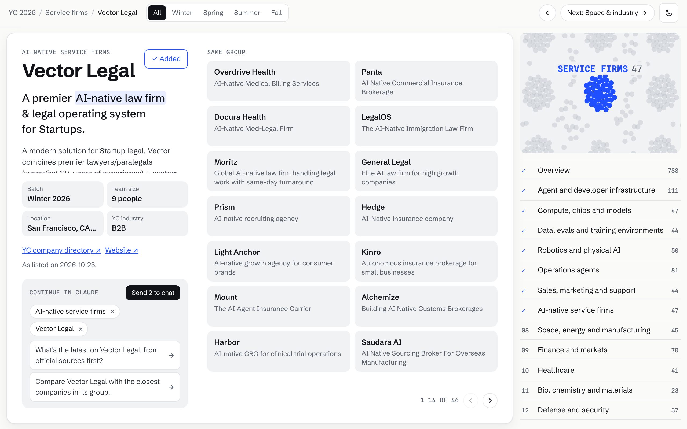
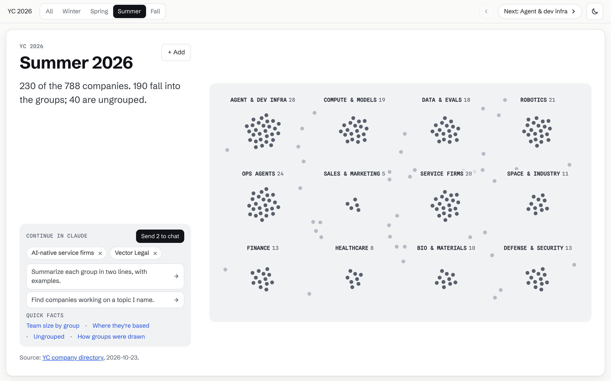
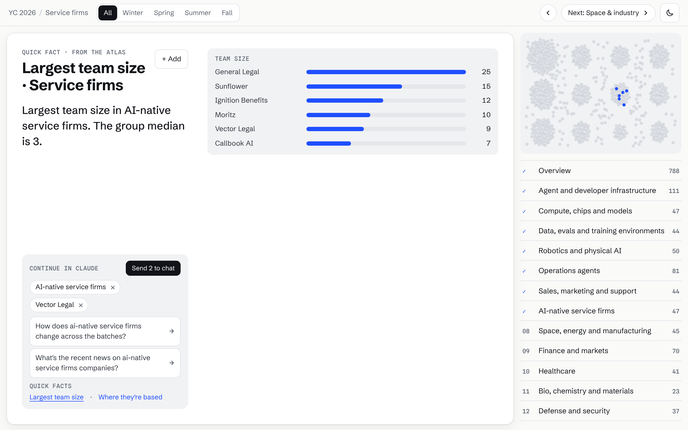

# Atlas Briefing

A Claude skill that turns a big collection into a one-screen briefing you can page through, filter and pick from, then hands your picks to your Claude chat for the follow-up.

Point it at something with too many entries to read ("every company in YC's 2026 batches", "every talk at this conference", "this year's grant awards"). Claude sharpens what you want from it, reads the official source, groups the items with quoted evidence, and publishes an interactive atlas as a Claude artifact. You get the lay of the land in a few minutes without scrolling a list or opening tabs.



## What it's good for

Collections of 50 to 600 comparable things (up to about 1,200 with a filter), listed by one official source, where each item describes itself and the reader wants the spread rather than one answer: accelerator batches, conference programmes, grant awards, bills in a session, trial registries, exhibitor lists, open-source ecosystems.

Not for rankings, timelines, single deep subjects, live data, or anything without a source of record. [The fit guide](skills/atlas-briefing/references/fit-guide.md) has examples of both, the analysis an atlas answers instantly versus what goes to research, and how to choose sources. The skill checks requests against it before building.

## What the viewer gets

| | |
|---|---|
| **One screen, like slides.** ← → through an overview and one page per group. Nothing scrolls on a laptop; long groups page in sets. |  |
| **Evidence you can see.** Each item's own one-liner, with the phrase that put it in its group highlighted. Placements without such a phrase are labelled *judgment call*. |  |
| **Slices that compare.** A filter (here: Winter, Spring, Summer, Fall) narrows the whole atlas to one slice. Clusters resize, and each group shows how it splits across slices. |  |
| **Quick facts.** Rankings, places, the ungrouped items and "how were these grouped?" answer at once from the data. |  |
| **Continue in Claude.** "+ Add" collects pages, groups and companies into a tray at the foot of the left column. They reach the Claude chat beside the atlas as one attachment, with what you're viewing, so you can ask about several at once. Suggested questions send the tray with the question. | |

Light and dark themes; keyboard: ← → page, `A` add, `Esc` back.

## How it works

```
You: "make an atlas of …"
 │
 ├─ 1 Intent     up to 3 questions, each with a default: who it's for, the exact collection, the source of record
 ├─ 2 Collect    items from the official source; summaries copied verbatim, facts left null when not stated
 ├─ 3 Group      4–12 groups with rubrics; membership needs a phrase quoted from the item's own summary
 ├─ 4 Validate   scripts/build.mjs refuses unquoted evidence and counts the data doesn't support
 └─ 5 Publish    prebuilt player + inlined data → one HTML page → Claude artifact
                         │
          viewer pages, filters, picks with "+ Add"
                         │
          picks + question → the viewer's own Claude chat → answered there, web research cited
```

Cost: building an atlas is one Claude conversation. Viewing it costs nothing; follow-up questions run in the viewer's own Claude chat. No API keys, servers or third-party services.

## Install

Copy or symlink the skill folder into your Claude skills:

```bash
git clone https://github.com/mahtabsoin/atlas-briefing
ln -s "$PWD/atlas-briefing/skills/atlas-briefing" ~/.claude/skills/atlas-briefing
```

The skill needs Node 18+ and nothing else: the player ships prebuilt in `skills/atlas-briefing/assets/player.html`. In a Claude chat, upload the `skills/atlas-briefing` folder as a skill.

## Use

- **Build:** "Make an atlas of every company in YC's 2026 batches for a journalist who covers AI." Answer the intent questions or say "go".
- **Explore:** page, filter, open quick facts.
- **Follow up:** "+ Add" what interests you, then ask in your chat or press a suggested question.

Sharing: an atlas declares only the `room` capability, so it can be shared by public link. Where a viewer has no chat beside the atlas, hand-offs are copied as text to paste instead, and the page says so.

## Example: YC 2026

[`atlases/yc-2026/collection.json`](atlases/yc-2026/collection.json): all 788 companies in YC's four 2026 batches (Winter 197, Spring 193, Summer 230, Fall 168), read 2026-10-23 from YC's directory index through the [yc-oss/api](https://github.com/yc-oss/api) daily mirror. 640 fall into twelve groups (one judgment call); 148 are ungrouped. Rebuild it with:

```bash
node skills/atlas-briefing/scripts/build.mjs atlases/yc-2026/collection.json
```

## Limits

- Built for 50 to 600 items and 4 to 8 groups; up to about 1,200 items and 12 groups with a filter. Split bigger collections.
- An atlas is a snapshot of its source on the date shown. Rebuild to refresh.
- Quick facts only know the atlas; anything beyond it (news, money) goes to the chat, where Claude researches it on the web.
- Handing picks to a chat needs the atlas open beside a Claude conversation. Elsewhere (a plain file, some public-link views) the hand-off is copied as text, the one place copying is unavoidable.
- No voice: artifacts can't use the microphone in Claude today.

## Repository

| Path | What |
|---|---|
| [`skills/atlas-briefing/`](skills/atlas-briefing/) | The skill: instructions, fit guide, data format, builder, prebuilt player |
| [`atlases/yc-2026/`](atlases/yc-2026/) | The worked example |
| [`player/`](player/) | Player source (React + Vite) for changing the page itself |
| `docs/screenshots/` | The images above |
